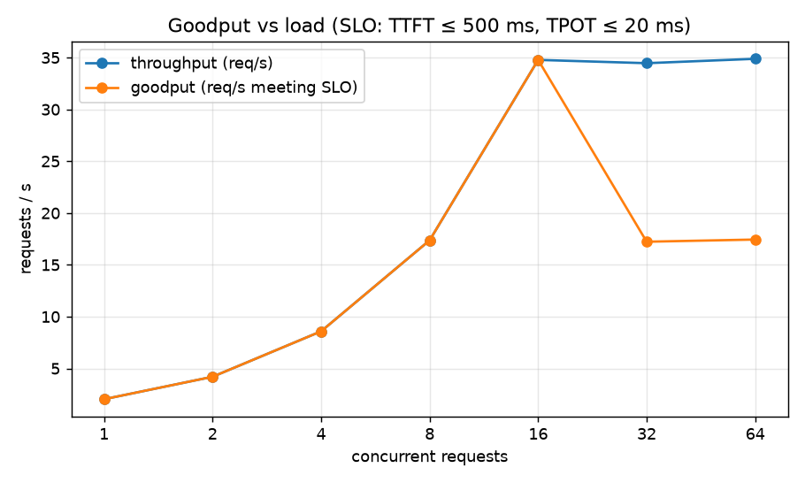
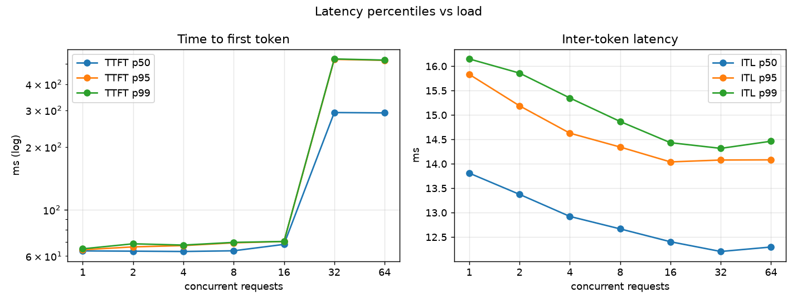

# tokenbench

Load-testing harness for LLM inference servers: TTFT, inter-token latency and throughput under rising concurrency, with reproducible latency curves.

Project 2 of 15 in [inference-infra-portfolio](https://github.com/NomanJafar/inference-infra-portfolio). Every later project in the portfolio measures with this package, so its methodology ([CONCEPTS.md](CONCEPTS.md)) matters more than its code.

## What it does

- **Closed-loop** sweeps (N concurrent users) and **open-loop** sweeps (Poisson arrivals at a fixed request rate), because they answer different questions and only the open loop finds the saturation point without coordinated omission.
- Measures **TTFT, inter-token latency, TPOT and end-to-end** per request from the stream itself, and reports p50/p95/p99 with sample counts.
- Reports throughput in all three units (output tokens/s, total tokens/s, requests/s) and **goodput** under an SLO (`--slo-ttft-ms`, `--slo-tpot-ms`).
- Samples the server's `/metrics` during each level so the write-up can say *why* a curve bent (queueing, KV cache, scheduler cap).
- Ships **`tokenbench mockserver`**: an OpenAI-compatible fake with configurable TTFT, ITL, a concurrency cap that queues, fault injection, and vLLM-style `/metrics`. Projects 4, 11, 12, 13 and 14 are developed against it on a laptop.
- Outputs JSON (full config and per-request records), CSV (per-level aggregates), PNG plots and a Markdown table ready for a README.

## Install

```bash
pip install "tokenbench[plots] @ git+https://github.com/NomanJafar/tokenbench"
```

## Usage

```bash
# closed loop: concurrency sweep, fixed 256-token prompts, exactly 128 output tokens each
tokenbench sweep --base-url http://localhost:8000 --model Qwen/Qwen2.5-1.5B-Instruct \
  --out results/closed.json --levels 1,2,4,8,16,32,64 --slo-ttft-ms 500 --slo-tpot-ms 50 --plots

# open loop: request-rate sweep with realistic length distribution, 60 s per level
tokenbench sweep --base-url http://localhost:8000 --model Qwen/Qwen2.5-1.5B-Instruct \
  --out results/open.json --mode open --levels 1,2,4,8 --duration 60 --prompts sample --max-tokens 512

# the mock server
tokenbench mockserver --port 8001 --ttft-ms 80 --itl-ms 12 --capacity 32
```

Results are checkpointed after every level, because free-tier GPU sessions die.

## Demo: what a saturation curve looks like

Closed-loop sweep against the mock server configured with `--ttft-ms 60 --itl-ms 12 --capacity 16` (32 requests per level, 32 output tokens each, SLO: TTFT ≤ 500 ms, TPOT ≤ 20 ms). Files in [`results/mock_demo/`](results/mock_demo/).

| level | req | err | out tok/s | TTFT p50 | TTFT p95 | ITL p50 | ITL p95 | TPOT p50 | SLO pass | goodput req/s |
|---|---|---|---|---|---|---|---|---|---|---|
| 1 | 32 | 0 | 65 | 64 ms | 64 ms | 13.8 ms | 15.8 ms | 13.8 ms | 100% | 2.03 |
| 2 | 32 | 0 | 134 | 63 ms | 66 ms | 13.4 ms | 15.2 ms | 13.3 ms | 100% | 4.20 |
| 4 | 32 | 0 | 275 | 63 ms | 67 ms | 12.9 ms | 14.6 ms | 12.9 ms | 100% | 8.58 |
| 8 | 32 | 0 | 556 | 64 ms | 69 ms | 12.7 ms | 14.3 ms | 12.7 ms | 100% | 17.37 |
| 16 | 32 | 0 | 1113 | 68 ms | 70 ms | 12.4 ms | 14.0 ms | 12.3 ms | 100% | 34.78 |
| 32 | 32 | 0 | 1103 | 292 ms | 526 ms | 12.2 ms | 14.1 ms | 12.2 ms | 50% | 17.23 |
| 64 | 32 | 0 | 1116 | 291 ms | 520 ms | 12.3 ms | 14.1 ms | 12.3 ms | 50% | 17.44 |




Reading it the way CONCEPTS.md section 8 describes: throughput is linear in concurrency up to the capacity of 16, then flat. Beyond 16, ITL does not move (the mock's decode speed is fixed) but TTFT jumps 4× because requests queue for a slot, and goodput halves because the queued requests miss the TTFT target. On a real GPU the ITL line also rises once decode stops being memory-bound; that is what the GPU validation run is for.

Note the ITL p50 of 12–14 ms against a configured 12 ms: the extra ~1 ms is Python/asyncio overhead on the client side, visible exactly as section 7 warns.

## GPU validation

`notebooks/kaggle_tokenbench.ipynb` runs the same closed-loop sweep as [servellm](https://github.com/NomanJafar/servellm) on a T4 with vLLM, plus an open-loop rate sweep with the sample prompts, so projects 1 and 2 cross-check each other. Results will be added here once that run lands.

## Layout

```
CONCEPTS.md              methodology: the four latencies, open vs closed loop, coordinated omission,
                         percentiles, goodput, what to control and record
src/tokenbench/
  metrics.py             RequestRecord, percentiles, aggregate(), SLO goodput
  client.py              streaming OpenAI-compatible client with per-token timestamps
  load.py                closed-loop and open-loop generators, /metrics timeline sampling
  prompts.py             fixed-shape prompts and the bundled 300-row sample (synthetic lengths)
  mockserver.py          the fake server
  report.py              JSON / CSV / plots / Markdown
  cli.py                 `tokenbench sweep`, `tokenbench mockserver`
tests/                   32 tests; timing tests run the mock in a real uvicorn thread because
                         httpx's in-process transport buffers streams and hides timing
```

## Running the tests

```bash
python -m venv .venv && source .venv/bin/activate
pip install -e ".[dev]"
pytest
```

## Hardware notes

Developed against free-tier GPUs (Kaggle and Colab T4, 16 GB). Where a T4 limits what can be measured, the README says so rather than papering over it.

## License

MIT
