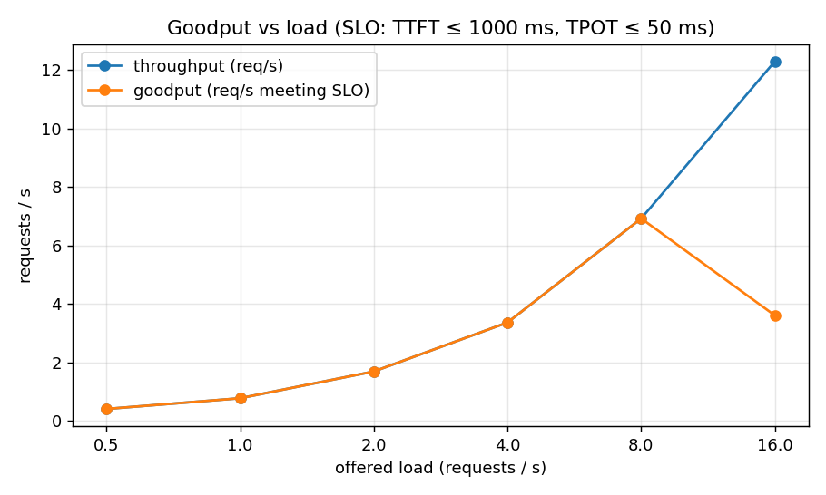
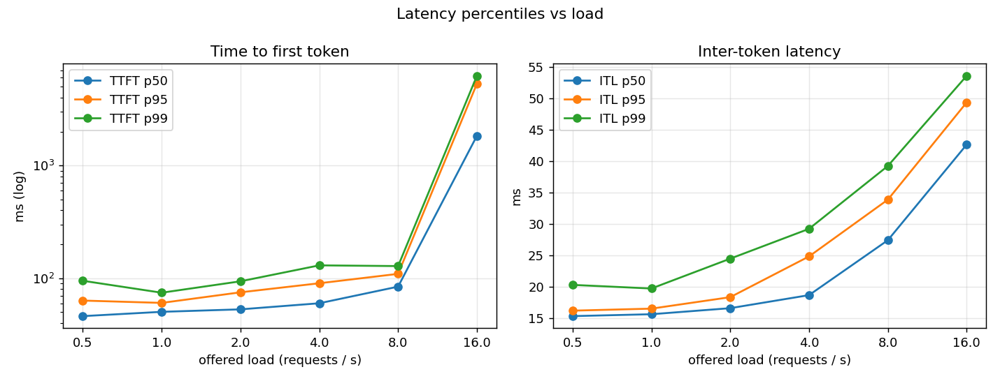

# tokenbench

Load-testing harness for LLM inference servers: TTFT, inter-token latency and throughput under rising concurrency, with reproducible latency curves.

Project 2 of 15 in [inference-infra-portfolio](https://github.com/NomanJafar/inference-infra-portfolio). Every later project in the portfolio measures with this package, so its methodology ([CONCEPTS.md](CONCEPTS.md)) matters more than its code.

## What it does

- **Closed-loop** sweeps (N concurrent users) and **open-loop** sweeps (Poisson arrivals at a fixed request rate), because they answer different questions and only the open loop finds the saturation point without coordinated omission.
- Measures **TTFT, inter-token latency, TPOT and end-to-end** per request from the stream itself, and reports p50/p95/p99 with sample counts.
- Reports throughput in all three units (output tokens/s, total tokens/s, requests/s) and **goodput** under an SLO (`--slo-ttft-ms`, `--slo-tpot-ms`).
- Samples the server's `/metrics` during each level so the write-up can say *why* a curve bent (queueing, KV cache, scheduler cap).
- Ships **`tokenbench mockserver`**: an OpenAI-compatible fake with configurable TTFT, ITL, a concurrency cap that queues, fault injection, and vLLM-style `/metrics`. Projects 4, 11, 12, 13 and 14 are developed against it on a laptop.
- Outputs JSON (full config and per-request records), CSV (per-level aggregates), PNG plots and a Markdown table ready for a README.

## Install

```bash
pip install "tokenbench[plots] @ git+https://github.com/NomanJafar/tokenbench"
```

## Usage

```bash
# closed loop: concurrency sweep, fixed 256-token prompts, exactly 128 output tokens each
tokenbench sweep --base-url http://localhost:8000 --model Qwen/Qwen2.5-1.5B-Instruct \
  --out results/closed.json --levels 1,2,4,8,16,32,64 --slo-ttft-ms 500 --slo-tpot-ms 50 --plots

# open loop: request-rate sweep with realistic length distribution, 60 s per level
tokenbench sweep --base-url http://localhost:8000 --model Qwen/Qwen2.5-1.5B-Instruct \
  --out results/open.json --mode open --levels 1,2,4,8 --duration 60 --prompts sample --max-tokens 512

# the mock server
tokenbench mockserver --port 8001 --ttft-ms 80 --itl-ms 12 --capacity 32
```

Results are checkpointed after every level, because free-tier GPU sessions die.

## Demo: what a saturation curve looks like

Closed-loop sweep against the mock server configured with `--ttft-ms 60 --itl-ms 12 --capacity 16` (32 requests per level, 32 output tokens each, SLO: TTFT ≤ 500 ms, TPOT ≤ 20 ms). Files in [`results/mock_demo/`](results/mock_demo/).

| level | req | err | out tok/s | TTFT p50 | TTFT p95 | ITL p50 | ITL p95 | TPOT p50 | SLO pass | goodput req/s |
|---|---|---|---|---|---|---|---|---|---|---|
| 1 | 32 | 0 | 65 | 64 ms | 64 ms | 13.8 ms | 15.8 ms | 13.8 ms | 100% | 2.03 |
| 2 | 32 | 0 | 134 | 63 ms | 66 ms | 13.4 ms | 15.2 ms | 13.3 ms | 100% | 4.20 |
| 4 | 32 | 0 | 275 | 63 ms | 67 ms | 12.9 ms | 14.6 ms | 12.9 ms | 100% | 8.58 |
| 8 | 32 | 0 | 556 | 64 ms | 69 ms | 12.7 ms | 14.3 ms | 12.7 ms | 100% | 17.37 |
| 16 | 32 | 0 | 1113 | 68 ms | 70 ms | 12.4 ms | 14.0 ms | 12.3 ms | 100% | 34.78 |
| 32 | 32 | 0 | 1103 | 292 ms | 526 ms | 12.2 ms | 14.1 ms | 12.2 ms | 50% | 17.23 |
| 64 | 32 | 0 | 1116 | 291 ms | 520 ms | 12.3 ms | 14.1 ms | 12.3 ms | 50% | 17.44 |


Reading it the way CONCEPTS.md section 8 describes: throughput is linear in concurrency up to the capacity of 16, then flat. Beyond 16, ITL does not move (the mock's decode speed is fixed) but TTFT jumps 4× because requests queue for a slot, and goodput halves because the queued requests miss the TTFT target. On a real GPU the ITL line also rises once decode stops being memory-bound; that is what the GPU validation run is for.

Note the ITL p50 of 12–14 ms against a configured 12 ms: the extra ~1 ms is Python/asyncio overhead on the client side, visible exactly as section 7 warns.

## GPU validation

`notebooks/kaggle_tokenbench.ipynb` runs the same closed-loop sweep as [servellm](https://github.com/NomanJafar/servellm) on a T4 with vLLM, plus an open-loop rate sweep with the sample prompts, so projects 1 and 2 cross-check each other. Raw data: [`results/kaggle_run1/`](results/kaggle_run1/).

### Closed loop: cross-check against servellm (Qwen2.5-1.5B FP16, 256-token prompts, 128 output tokens)

| level | req | err | out tok/s | TTFT p50 | TTFT p95 | ITL p50 | ITL p95 | TPOT p50 | SLO pass | goodput req/s |
|---|---|---|---|---|---|---|---|---|---|---|
| 1 | 32 | 0 | 66 | 28 ms | 32 ms | 15.1 ms | 15.8 ms | 15.5 ms | 100% | 0.52 |
| 2 | 32 | 0 | 126 | 45 ms | 52 ms | 15.7 ms | 16.4 ms | 16.2 ms | 100% | 0.98 |
| 4 | 32 | 0 | 241 | 50 ms | 65 ms | 16.3 ms | 17.2 ms | 16.8 ms | 100% | 1.88 |
| 8 | 32 | 0 | 440 | 65 ms | 84 ms | 17.7 ms | 19.1 ms | 18.3 ms | 100% | 3.44 |
| 16 | 32 | 0 | 746 | 115 ms | 130 ms | 20.6 ms | 22.4 ms | 21.3 ms | 100% | 5.83 |
| 32 | 32 | 0 | 1058 | 197 ms | 202 ms | 28.7 ms | 31.2 ms | 29.8 ms | 100% | 8.27 |
| 64 | 32 | 0 | 1059 | 202 ms | 206 ms | 28.7 ms | 31.6 ms | 29.7 ms | 100% | 8.27 |

SLO: TTFT ≤ 500 ms and TPOT ≤ 50 ms. Goodput counts only requests meeting both.

Against servellm's independent client the numbers agree within 2–5% at 1–32 users (e.g. 1,058 vs 1,116 tok/s at 32; ITL 28.7 vs 27.4 ms). The 64 row is **not** a 64-user measurement: it was run with `--num-requests 32`, so only 32 requests ever existed and the row duplicates the 32 row (servellm measured 1,637 tok/s at a real 64). tokenbench now raises `num_requests` to 2x the concurrency and says so, so this cannot recur silently; the row is kept as the reason for that rule.

### Open loop: finding the saturation point (sample prompt distribution, up to 256 output tokens, 45 s per level)

| level | req | err | out tok/s | TTFT p50 | TTFT p95 | ITL p50 | ITL p95 | TPOT p50 | SLO pass | goodput req/s |
|---|---|---|---|---|---|---|---|---|---|---|
| 0.5 | 19 | 0 | 76 | 46 ms | 63 ms | 15.4 ms | 16.2 ms | 15.5 ms | 100% | 0.41 |
| 1.0 | 37 | 0 | 139 | 50 ms | 61 ms | 15.7 ms | 16.5 ms | 15.8 ms | 100% | 0.77 |
| 2.0 | 81 | 0 | 296 | 53 ms | 75 ms | 16.6 ms | 18.4 ms | 16.9 ms | 100% | 1.69 |
| 4.0 | 166 | 0 | 581 | 60 ms | 90 ms | 18.7 ms | 24.9 ms | 19.2 ms | 100% | 3.36 |
| 8.0 | 347 | 0 | 1133 | 84 ms | 109 ms | 27.4 ms | 33.9 ms | 27.5 ms | 100% | 6.92 |
| 16.0 | 716 | 0 | 2013 | 1833 ms | 5305 ms | 42.7 ms | 49.4 ms | 43.1 ms | 29% | 3.60 |

SLO: TTFT ≤ 1000 ms and TPOT ≤ 50 ms. Goodput counts only requests meeting both.




### What the numbers say

1. **The saturation point for this prompt mix is between 8 and 16 requests/s.** At 8 req/s: TTFT p50 84 ms, p95 109 ms, every request within SLO, 54 requests in flight at peak. At 16 req/s: TTFT p50 1.8 s and p95 5.3 s, 99 in flight, 29% within SLO, and the level took 58 s to drain 45 s of arrivals. The server was still generating 2,013 tok/s (more than at 8 req/s) but almost none of it met the latency target: **throughput rose, goodput fell by half.** That is the whole point of measuring goodput.
2. **Queueing happened outside `num_requests_waiting`.** The scheduler's waiting queue stayed at 0 even at 16 req/s; `max_num_seqs` is 256, so everything was admitted immediately. TTFT grew because ~100 admitted requests' prefills and decodes shared the GPU. A server-side "waiting" metric of 0 does not mean nobody is waiting.
3. **Little's law check:** at 16 req/s with median E2E 9.0 s, about 145 requests should be in flight; the server reported up to 99 running and the client held the rest in its own HTTP connection pool. A closed-loop test at 16 workers would have reported 115 ms TTFT for the same server (the row above): the open loop is what showed the cliff.
4. **ITL percentiles spread under load** (p50 42.7, p95 49.4, p99 53.6 ms at 16 req/s vs 15.4/16.2/20.4 ms at 0.5 req/s): prefill of arriving requests interrupting decode (project 8).
5. **KV cache was never the limit** (peak 4.8% at 16 req/s). On this model and card, the T4's compute saturates long before its 9 GiB of cache fills.
6. **Prefix caching was on by default** (`enable_prefix_caching=True` in vLLM 0.31's startup config) and the closed-loop sweep used one fixed prompt, so all workers shared the prompt's blocks. KV usage at 64 in the servellm run was 2.8% rather than the ~5.5% the arithmetic gives because only generated tokens cost new blocks. Fixed prompts measure latency well and cache usage badly; the sample distribution is the one to use for memory questions.

### What was not measured

The closed-loop knee beyond 32 real users; open-loop levels between 8 and 16 req/s (the exact saturation rate); anything with prefix caching disabled.

## Layout

```
CONCEPTS.md              methodology: the four latencies, open vs closed loop, coordinated omission,
                         percentiles, goodput, what to control and record
src/tokenbench/
  metrics.py             RequestRecord, percentiles, aggregate(), SLO goodput
  client.py              streaming OpenAI-compatible client with per-token timestamps
  load.py                closed-loop and open-loop generators, /metrics timeline sampling
  prompts.py             fixed-shape prompts and the bundled 300-row sample (synthetic lengths)
  mockserver.py          the fake server
  report.py              JSON / CSV / plots / Markdown
  cli.py                 `tokenbench sweep`, `tokenbench mockserver`
tests/                   32 tests; timing tests run the mock in a real uvicorn thread because
                         httpx's in-process transport buffers streams and hides timing
```

## Running the tests

```bash
python -m venv .venv && source .venv/bin/activate
pip install -e ".[dev]"
pytest
```

## Hardware notes

Developed against free-tier GPUs (Kaggle and Colab T4, 16 GB). Where a T4 limits what can be measured, the README says so rather than papering over it.

## License

MIT
